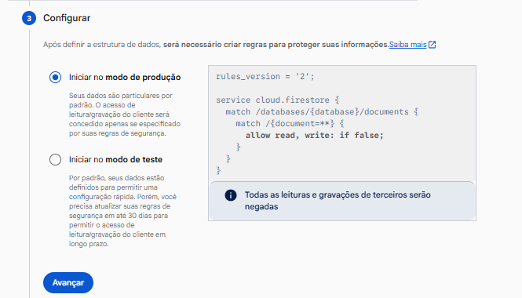
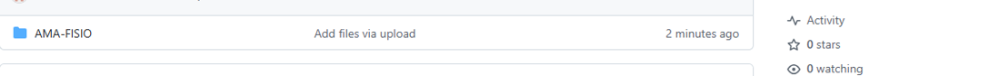
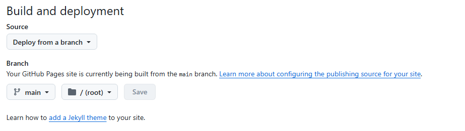

# AMA FISIO — GUIA COMPLETO DE CONFIGURAÇÃO

**Novo projeto | GitHub Pages + Firebase Console | Apenas navegador | Edição de 14/10/2026**

Este manual corresponde **à versão dos arquivos contidos neste pacote**. Os nomes dos menus e botões foram comparados com a documentação oficial e com as telas do Firebase e do GitHub que você apresentou. Dependendo do idioma da conta ou de pequenas mudanças da interface, alguns rótulos podem aparecer em inglês.

> **Leia antes de começar:** esta versão **já tem o acesso mestre configurado**, com o login **Amanda Marinho** e a senha que você definiu anteriormente. Não precisa cadastrar Amanda no Firebase, nem habilitar Firebase Authentication. Porém, **o site salva clientes, agenda e usuários somente no navegador, em um cofre local criptografado**. O Firebase é configurado para o futuro, mas **não recebe nem sincroniza cadastros nesta versão**. As Rules ficarão fechadas de propósito. O site não está aprovado para uso com dados clínicos reais de pacientes.

## Roteiro rápido — o que vai acontecer

| Etapa | Onde você estará | Resultado esperado |
|---|---|---|
| 1 | Arquivos do ZIP | Confirmar os arquivos certos para publicar |
| 2 | Firebase Console | Criar **um projeto novo**, separado do anterior |
| 3 | Firebase → Seus aplicativos | Registrar o app da Web e copiar a configuração |
| 4 | Firebase → Firestore | Criar **Cloud Firestore Standard**, banco **`(default)`** |
| 5 | Firebase → Firestore → Regras | Colar as Rules seguras e clicar em **Publicar** |
| 6 | GitHub → Novo repositório | Criar repositório diferente do antigo |
| 7 | GitHub → Code → Add file | Enviar `index.html`, `app.js`, `styles.css` e `assets/logo.webp` na estrutura correta |
| 8 | GitHub → Settings → Pages | Ativar `Deploy from a branch` com `main` e `/(root)` |
| 9 | AMA FISIO → Login | Entrar com a conta mestre já existente |
| 10 | AMA FISIO → Configurações | Anotar os campos Firebase e baixar backup local |
| 11 | AMA FISIO → Clientes/Agenda/Usuários | Testar com **dados fictícios** e reconhecer as limitações |

---

## ETAPA 1 — Preparar a pasta correta (no seu computador)

1. Baixe o ZIP **AMA-FISIO-GUIA-DETALHADO-E-PROJETO.zip**.
2. No Windows, abra **Explorador de Arquivos → Downloads**.
3. Clique com o botão direito no ZIP → **Extrair Tudo...** (ou **Extrair aqui**, conforme seu descompactador).
4. Entre na pasta extraída. **O arquivo `index.html` deve estar visível dentro dela**, e não escondido em outra subpasta chamada `docs`.
5. Confirme esta estrutura:

```text
PASTA EXTRAÍDA (NÃO ENVIAR COMO UMA PASTA ÚNICA)
├── index.html                 ← página inicial; obrigatório
├── app.js                     ← lógica de login/cadastro/agenda; obrigatório
├── styles.css                 ← aparência do site; obrigatório
├── assets/
│   └── logo.webp              ← logo original; obrigatório
├── firestore.rules            ← copiar no Firebase; não é carregado pelo site
├── firebase-config.EXEMPLO.js ← exemplo para consulta; não ativado automaticamente
├── GUIA-COMPLETO-COM-TELAS.md ← este manual
├── GUIA-COMPLETO-COM-TELAS.pdf ← este manual em PDF
├── LEIA-PRIMEIRO.md
├── NOTAS-DE-ACESSO.md
├── PROMPT-PARA-FUTURAS-MELHORIAS.md
└── .nojekyll / .gitignore     ← arquivos opcionais/ocultos
```

**Muito importante:** não envie outro ZIP antigo do AMA FISIO, nem as pastas antigas `AMA-FISIO-PRONTO`, `AMA-FISIO-LOGIN-ESTAVEL`, `docs` ou `.github/workflows`. Este projeto novo usa **arquivos simples na raiz**, sem `npm`, sem Node.js, sem Firebase CLI, sem GitHub Actions e sem Firebase Hosting.

**Prevenção de erro antigo:** corrigi no arquivo `app.js` o nome do cofre local para **`ama_fisio_novo_2026_cofre_v4`**, diferente das versões anteriores. Isso evita que o navegador carregue o cofre de outro AMA FISIO publicado sob a mesma conta do GitHub Pages.

---

## ETAPA 2 — Criar um novo projeto no Firebase

**Endereço oficial:** https://console.firebase.google.com/

1. Acesse o endereço acima e faça login em sua conta Google.
2. Na página com seus projetos, clique em **Adicionar projeto** / **Criar projeto** / **Create a project** (o botão pode variar segundo o contexto).
3. Em **Nome do projeto**, digite **AMA FISIO — NOVO SISTEMA**. Esse é o nome exibido no console.
4. Se o assistente mostrar **ID do projeto** e permitir editar, sugiro **`ama-fisio-novo-2026`**. **Esse é apenas um exemplo:** se já existir, o Firebase atribuirá outro identificador. Anote o **ID real**, pois ele não poderá ser alterado após a criação.
5. Clique em **Continuar**.
6. Em **Google Analytics**, selecione **Desativar** se a página oferecer a opção. O AMA FISIO não depende do Analytics.
7. Clique em **Criar projeto** / **Adicionar Firebase** e aguarde a conclusão.
8. Ao ver **Seu novo projeto está pronto**, clique em **Continuar** ou acesse **Visão geral do projeto**.
9. Confira na lateral inferior que o plano é **Spark**. **Não clique em “Fazer upgrade”**.

**O que anotar (somente em suas anotações privadas):** nome exibido, **ID real do projeto** e a conta Google que possui acesso ao console. Não use dados do antigo projeto `ama-fisio` neste novo cadastro.

**Se o Firebase perguntar se deseja vincular o Google Analytics:** neste projeto, pode deixar desativado. **Se a opção não aparecer**, apenas siga o assistente normalmente; ela não afeta o guia.

---

## ETAPA 3 — Registrar o aplicativo Web e obter a configuração correta

Comece dentro do **projeto NOVO** criado na etapa anterior.

1. Clique na engrenagem de **Configurações do projeto** (normalmente ao lado de **Visão geral do projeto** ou no menu esquerdo).
2. Entre em **Configurações do projeto → Geral**.
3. Role a página até a seção **Seus aplicativos**.
4. Clique no ícone **Web** com o símbolo **`</>`**. Se houver outros aplicativos, clique antes em **Adicionar aplicativo**.
5. Em **Apelido do app**, escreva exatamente **AMA FISIO — WEB**.
6. Se aparecer **Configurar o Firebase Hosting também**, **deixe desmarcado**. Quem hospedará a página será o **GitHub Pages**.
7. Clique em **Registrar app**.
8. No passo **Adicionar o SDK do Firebase**, você poderá ver opções como **npm** e **Usar a tag `<script>`**. **Não execute `npm install firebase`**; este pacote já funciona como site estático.
9. Clique em **Continuar no console**, se disponível.
10. De volta a **Configurações do projeto → Geral → Seus aplicativos → AMA FISIO — WEB**, encontre a seção **Configuração do SDK**.
11. Clique em **Config**. Se aparecerem outras abas, como **NPM** e **CDN**, use **Config** para copiar o bloco `firebaseConfig`.
12. Copie os **valores**, não as linhas `import ...` nem `getAnalytics`.

**Exemplo ilustrativo (NÃO copie esses valores fictícios):**

```javascript
const firebaseConfig = {
  apiKey: "CHAVE_DO_SEU_NOVO_PROJETO",
  authDomain: "SEU-ID.firebaseapp.com",
  projectId: "SEU-ID-REAL",
  storageBucket: "SEU-ID.firebasestorage.app",
  messagingSenderId: "NUMERO_DO_SEU_PROJETO",
  appId: "1:NUMERO:web:IDENTIFICADOR"
};
```

**Quais valores serão usados dentro do site?** `projectId`, `apiKey`, `authDomain`, `appId` e, opcionalmente, `messagingSenderId`.

**Atenção:** `apiKey` de um app Firebase Web é um identificador do projeto, **não é sua senha mestre**. Também **não autoriza acesso ao banco**. Não copie arquivos JSON de conta de serviço, chaves privadas ou senhas de usuários para o GitHub.

**Se você fechar o assistente sem copiar:** não precisa registrar outro app. Volte a **Configurações do projeto → Geral → Seus aplicativos**, escolha o app e abra **Configuração do SDK → Config**.

---

## ETAPA 4 — Criar o banco de dados correto: Cloud Firestore

**Nesta etapa, use `Firestore`, não `Realtime Database`. São produtos diferentes.**

1. No menu esquerdo do Firebase, expanda **Bancos de dados e armazenamento** (em alguns layouts o grupo é chamado **Build**).
2. Clique em **Firestore Database**, **Firestore** ou **Banco de dados do Firestore**.
3. Clique no botão **Criar banco de dados**.
4. Se a tela pedir **Edição** ou **Tipo**, selecione **Standard**. Não escolha Enterprise para este guia.
5. No campo **ID do banco de dados**, quando existir, use **`(default)`**, que é o banco padrão. **Não escreva `clientes`, `agendamentos` ou `ama-fisio` como ID do banco.**
6. Em **Localização**, selecione **`southamerica-east1` — São Paulo**, se disponível. Se a localização já estiver definida e não permitir alterar, não tente contornar: prossiga e anote a região indicada.
7. Na tela **Configurar**, escolha **Iniciar no modo de produção**. Não escolha modo de teste.
8. Clique em **Avançar** e depois em **Criar** ou **Ativar**, conforme o assistente mostrar.
9. Aguarde a tela **Banco de dados** abrir com as abas **Dados**, **Regras** e **Índices**. Se aparecer **“Seu banco de dados está pronto, basta adicionar dados”**, a criação foi concluída.
10. **Não clique em “Iniciar coleção”**. Nesta versão, não se criam coleções de clientes no Firebase.

**Como reconhecer a tela certa:** no topo aparecerá algo como **Cloud Firestore → Banco de dados → `(default)`**. O espaço de documentos pode estar vazio. Isso **não é erro**.



*Imagem de referência enviada anteriormente: selecionando **modo de produção**.*

---

## ETAPA 5 — Colar e PUBLICAR as Firestore Rules

Este é o procedimento exato para sua pergunta **“o que faço em Rules?”**.

1. Ainda no projeto **NOVO**, abra **Firestore → Banco de dados**.
2. No alto da página, clique na aba **Regras** (ao lado de **Dados**).
3. Você verá um editor com linhas `rules_version`, `service cloud.firestore` e `allow read, write`.
4. Selecione **todo o texto do editor**, apague e cole **exatamente** estas regras:

```javascript
rules_version = '2';
service cloud.firestore {
  match /databases/{database}/documents {
    match /{document=**} {
      allow read, write: if false;
    }
  }
}
```

5. Clique em **Publicar** / **Publish**. Se aparecer confirmação, confirme.
6. Aguarde até o console mostrar o horário da nova versão das regras.
7. Confira visualmente que a linha central é **`allow read, write: if false;`**.
8. Opcionalmente, abra **Desenvolver e testar** / **Rules Playground** e simule uma leitura não autenticada do documento `clientes/teste` (se o editor permitir esse caminho). O resultado esperado é **NEGADO**.

**Significado exato:** nenhum navegador visitante pode ler ou gravar documentos no Firestore. O banco ficará protegido, mesmo com a configuração Web (`apiKey`) visível. **Não é uma configuração para sincronizar dados**; os cadastros continuam no cofre local.

**NUNCA cole** `allow read, write: if true;` para fazê-lo “funcionar”: isso abriria os registros a qualquer pessoa na internet. O Firebase documenta expressamente esse risco.

**Não copie** as regras do projeto antigo que tinham o UID da Amanda. O novo projeto **não utiliza Firebase Authentication** nem UID mestre no Firestore.

### Como verificar se as Rules foram salvas

- A aba **Regras** mostra uma versão nova, com data e horário.
- No editor, existe **`if false`**, e não **`if true`**.
- O banco aparece vazio na aba **Dados**. Isso está correto para a versão atual.

---

## ETAPA 6 — Criar um REPOSITÓRIO NOVO no GitHub

**Endereço oficial:** https://github.com/new

1. Entre no GitHub com a conta que você utiliza para os seus sites.
2. Abra https://github.com/new ou clique no botão **`+` → New repository** / **Novo repositório**.
3. Em **Owner / Proprietário**, selecione a sua conta.
4. Em **Repository name / Nome do repositório**, informe **`ama-fisio-gestao-novo`**. Se esse nome já estiver sendo utilizado na sua conta, escolha outro nome e anote o nome final.
5. Em **Description**, você pode colocar **Sistema AMA FISIO — projeto demonstrativo e agenda local**.
6. Em **Visibility**, você pode escolher **Public** para usar o GitHub Pages no plano gratuito. Lembre-se: **o código será público, mas não envie pacientes ou senhas como arquivos**.
7. Em **Add a README file**, **deixe desmarcado**. Também não precisa adicionar `.gitignore` nem licença pelo assistente: os arquivos já estão no pacote.
8. Clique em **Create repository**.
9. Você verá a página **Quick setup**, com o link **uploading an existing file**. Isso significa que o repositório está pronto para receber os arquivos.

**Não reutilize o antigo repositório `ama-fisio`** neste reinício. O objetivo é eliminar misturas de versões e páginas antigas. Não precisa excluir o repositório anterior agora.

---

## ETAPA 7 — Enviar os arquivos DIRETAMENTE para a raiz do GitHub

Esta etapa é a causa mais comum dos erros **404**, CSS ausente ou logo quebrada.

1. Na página principal do **repositório novo**, clique na aba **Code**.
2. Se estiver vazio, clique em **uploading an existing file**. Se já houver arquivos, clique em **Add file → Upload files**.
3. No Explorador de Arquivos, abra a pasta extraída do ZIP.
4. **Selecione o conteúdo que está dentro dela; não faça upload do ZIP fechado e não envie uma pasta externa contendo tudo.**
5. Para garantir o mínimo necessário, envie: `index.html`, `styles.css`, `app.js` e a pasta `assets` com `logo.webp`. Pode incluir os manuais e `firestore.rules` como documentação; não são necessários para o site carregar.
6. Aguarde os nomes aparecerem na lista de upload do GitHub. A pasta **`assets`** precisa manter o arquivo `logo.webp` dentro dela.
7. Em **Commit changes**, deixe uma mensagem como **`Publicar nova versão AMA FISIO`**.
8. Clique no botão verde **Commit changes**.
9. Volte à aba **Code** e confirme que está visualizando a branch **`main`**.
10. Confira a estrutura **exatamente** assim no nível principal do repositório:

```text
ama-fisio-gestao-novo  [branch: main]
├── index.html           CORRETO: aparece imediatamente
├── app.js               CORRETO: aparece imediatamente
├── styles.css           CORRETO: aparece imediatamente
├── assets/              CORRETO: pasta na raiz
│   └── logo.webp
├── firestore.rules      opcional para documentação
└── ...documentação      opcional
```

**Estruturas INCORRETAS:**

```text
ama-fisio-gestao-novo/AMA-FISIO-MESTRE-PRONTO/index.html   ← errado
ama-fisio-gestao-novo/docs/index.html                      ← errado para raiz
ama-fisio-gestao-novo/AMA-FISIO-PRONTO/docs/index.html      ← errado
ama-fisio-gestao-novo/arquivo.zip                           ← não publica
```

**Se a estrutura ficar errada:** antes de ativar Pages, corrija a estrutura na aba Code; não tente adivinhar URLs com `/docs/`, `/v1.7/` ou outras pastas. O objetivo é **um único site, na raiz**.



*Referência visual de navegação do GitHub; confirme sempre o nome do repositório NOVO.*

---

## ETAPA 8 — Publicar com GitHub Pages sem instalar nada

1. Dentro do **repositório novo**, clique em **Settings** (aba superior, ao lado de **Insights**).
2. No menu esquerdo, procure **Code, planning, and automation → Pages**. Em português, pode aparecer **Código, planejamento e automação → Páginas**.
3. Na página **GitHub Pages**, localize **Build and deployment**.
4. Em **Source**, selecione **Deploy from a branch**.
5. Em **Branch**, selecione **`main`**.
6. Na opção de pasta, selecione **`/(root)`**. **Não selecione `/docs`**.
7. Clique no botão **Save**.
8. Aguarde a publicação. A página mostrará a mensagem **“Your site is live at...”** quando o deploy for concluído.
9. Clique em **Visit site** ou abra o endereço exibido.

**Formato previsto do endereço:**

```text
https://SEU-USUARIO.github.io/ama-fisio-gestao-novo/
```

O nome exato depende do **proprietário do GitHub** e do **repositório efetivamente criado**. Use o link exibido no seu GitHub; não copie um endereço de um projeto antigo.



*Na imagem aparecem **Source** e **Branch**. Para o NOVO projeto selecione `main` e `/(root)`.*

**O que NÃO é necessário:** GitHub Actions personalizado, `firebase-deploy.yml`, Firebase Hosting, credenciais de conta de serviço, Google Cloud IAM, Node.js, `npm` ou terminal do Windows. A publicação simples de HTML/CSS/JS é suportada pelo GitHub Pages.

---

## ETAPA 9 — Primeiro login no AMA FISIO

1. Abra o **link novo** do GitHub Pages, na tela indicada como **AMA FISIO / Bem-vinda de volta!**.
2. No campo **Usuário**, digite ou deixe preenchido **Amanda Marinho**.
3. No campo **Senha**, digite a senha mestre que você já definiu para este novo pacote. **Ela já está configurada: não há tela de criar conta.**
4. Clique em **Entrar no AMA FISIO**.
5. Confirme que foi aberto o **painel**, com opções laterais **Visão geral**, **Clientes**, **Agendamentos**, **Usuários** e **Configurações**.
6. Se desejar trocar a senha depois, faça isso no menu **Usuários → Trocar senha** da própria Amanda. Use uma senha longa e exclusiva antes de trabalhar com informações minimamente reais.

**Importante sobre a conta mestre:** o arquivo público contém um cofre inicial cifrado; isso não é uma proteção adequada para uma senha curta conhecida. O login local **não equivale a autenticação do Firebase**, e não oferece controle centralizado de aparelhos.

**Se a senha não funcionar no navegador usado antes:** possivelmente o navegador possui um cofre da versão antiga. O novo pacote utiliza outro identificador de armazenamento para evitar isso. Verifique se você publicou o `app.js` deste ZIP, se abriu o **novo endereço** e se a senha é exatamente a pré-configurada. **Não apague o armazenamento do navegador se houver cadastros sem backup.**

---

## ETAPA 10 — Informar as chaves do NOVO Firebase dentro do AMA FISIO

**Esta tela existe no código atual, mas é apenas para registrar a configuração; não envia nem baixa pacientes.**

1. Entre no AMA FISIO com a conta mestre.
2. No menu lateral, clique em **Configurações**.
3. Procure o painel **Firebase — apenas configuração**.
4. Em **Nome do projeto / projectId**, cole o **ID real** de seu Firebase novo.
5. Em **apiKey**, cole o valor `apiKey` obtido em **Configurações do projeto → Geral → Seus aplicativos → Config**.
6. Em **authDomain**, cole o valor correspondente, geralmente `ID.firebaseapp.com`.
7. Em **appId**, cole o identificador completo do aplicativo Web, que começa com `1:`.
8. Em **messagingSenderId (opcional)**, cole o número informado no bloco de configuração.
9. Clique em **Salvar configuração local**.
10. O site deverá mostrar **“Configuração anotada no navegador. O banco na nuvem continua bloqueado.”**

**Esse retorno é esperado.** Não significa falha. Significa que a tela anotou os identificadores no navegador, mas as Rules **corretamente não permitem sincronização**. Um Firebase configurado e vazio não é uma indicação de erro neste protótipo.

**Você não precisa modificar `firebase-config.EXEMPLO.js` para o site funcionar.** Ele é somente um modelo. O `index.html` carrega `app.js` e `styles.css` e usa a pasta `assets`.

---

## ETAPA 11 — Teste completo com registros FICTÍCIOS

**Não utilize informações verdadeiras de pacientes nesse teste.** Use, por exemplo, “Cliente Teste A” e datas fictícias.

### 11.1 Testar cadastro

1. Clique em **Clientes** no menu.
2. Clique em **Cadastrar cliente** / **Novo cliente**.
3. Preencha o **Nome completo** do exemplo.
4. Se desejar, informe **Telefone**, **Data de nascimento**, **Contato responsável** e **Origem do contato** fictícios.
5. Em **Observação administrativa**, não coloque diagnósticos ou dados clínicos.
6. Clique em **Salvar**.
7. Confirme que o cliente aparece na lista e pode ser encontrado pela pesquisa.
8. Recarregue a página com **Ctrl+R**, entre novamente e verifique se o cadastro fictício continua salvo.

### 11.2 Testar agenda e notificações

1. Clique em **Agendamentos**.
2. Clique em **Novo agendamento**.
3. Selecione **Cliente Teste A**.
4. Preencha **Data**, **Horário**, **Tipo de atendimento**, **Duração** e **Situação**.
5. No campo **Lembrete no sino 🔔**, escolha entre **Não lembrar**, **No dia**, **1 dia antes** ou **2 dias antes**.
6. Clique em **Salvar**.
7. No topo do painel, clique no **sino 🔔**.
8. Verifique as abas **Lembretes** e **Hoje**; quando um lembrete estiver no período escolhido, aparecerá no contador.
9. Clique em **Lido** para retirar um aviso pendente. Isso não apaga a consulta.

**Não há notificação fora do site.** O sino não envia e-mails, WhatsApp, SMS nem alertas de sistema com o navegador fechado.

### 11.3 Testar os usuários criados pela Amanda

1. Entre como Amanda e clique em **Usuários**.
2. Clique em **Criar usuário** / **Novo usuário**.
3. Defina o **Login do usuário** e uma senha fictícia de teste; confirme a senha.
4. Salve, saia e tente entrar com esse usuário, **no mesmo navegador**.
5. Volte à Amanda e confira os controles de **Trocar senha**, **Bloquear** e **Reativar**.

**Restrição atual:** funcionários criados no computador A **não conseguem automaticamente entrar no celular B**. Cada navegador tem seu próprio cofre; somente um backup restaurado leva esses dados a outro dispositivo, e a restauração substitui o cofre de destino.

---

## ETAPA 12 — Backup e troca de computador/celular

1. Dentro do site, clique em **Configurações**.
2. Na seção **Proteção e cópia de segurança**, clique **Baixar backup criptografado**.
3. Salve o arquivo `.json` em lugar privado e confiável. Não envie esse arquivo ao GitHub, mesmo cifrado.
4. Faça backup periodicamente; prefira antes e depois de alterações importantes.
5. Para usar outro navegador, abra o mesmo site nele, entre no AMA FISIO e vá a **Configurações → Restaurar backup**. Também existe a opção de restaurar cópia na tela de login.
6. Escolha o arquivo `.json` e confirme somente depois de ler o aviso de substituição.
7. Entre com a senha do cofre restaurado.

**Atenção máxima:** restaurar **substitui** os dados e usuários que já existirem no navegador de destino. **Não soma nem mescla cadastros.** Se você editar um cliente no computador e outro no celular, não haverá sincronização ou conciliação automática.

**Navegação anônima, limpar cookies/dados de sites, troca de aparelho ou falha do navegador** podem eliminar o cofre local. Sem backup, pode não ser possível recuperar os registros.

---

## ETAPA 13 — Erros que já aconteceram e como evitar

| Mensagem / problema | Causa provável | O que fazer |
|---|---|---|
| **404 — File not found** | `index.html` não está na raiz ou Pages publicou a pasta errada | Em **Code**, confira `index.html` na raiz; em **Settings → Pages**, confirme `main` + `/(root)` |
| **Página abre sem logo** | Faltou `assets/logo.webp` ou a pasta foi renomeada | Confira **Code → assets → logo.webp**; não renomeie o arquivo |
| **Sem cores / aparência quebrada** | `styles.css` ausente ou enviado dentro de subpasta | Confirme `styles.css` ao lado de `index.html` |
| **Aparece versão antiga** | Endereço antigo, cache ou `app.js` de outro ZIP | Confira o **novo URL**, `app.js` deste pacote e atualize com **Ctrl+Shift+R** |
| **Conta mestre não entra** | Senha incorreta ou cofre herdado de outra versão | Use senha mestre configurada e `app.js` novo; faça backup antes de limpar qualquer dado |
| **Firebase não mostra clientes** | **Comportamento esperado:** protótipo usa cofre local, não grava no Firestore | **Não abra Rules.** Para sincronização real é necessária arquitetura autenticada no servidor/Firebase |
| **Cliente sumiu em outro dispositivo** | `localStorage` não sincroniza aparelhos | Use backup/restauração, compreendendo que **substitui** o cofre do destino |
| **Funcionário não consegue entrar em outro aparelho** | Usuário criado apenas no cofre daquele navegador | Restaure backup no outro, ou planeje uma versão com autenticação centralizada |
| **Sino sem aviso** | Lembrete futuro/sem agendamento no período ou marcado como lido | Abra **Agendamentos**, confira a data e a opção de lembrete |
| **Erro de armazenamento / quota do navegador** | Limite ou bloqueio do armazenamento local | Faça backup antes de qualquer limpeza; não use como sistema clínico de produção |

---

## ETAPA 14 — O que NÃO ativar neste projeto e por quê

- **Firebase Authentication:** o pacote atual **não utiliza**, porque o login é local no navegador; não crie UID, e-mail de Amanda ou usuário mestre no Firebase.
- **Realtime Database:** não é o banco usado no guia. Se o criou por engano, pode deixá-lo sem uso e protegido; não é necessário para o site.
- **Firebase Hosting e App Hosting:** não são necessários; o site já é hospedado no **GitHub Pages**.
- **Firebase Cloud Functions / conta de serviço / chave JSON:** não são necessárias para a demonstração local. Não gere nem publique credenciais privadas.
- **GitHub Actions personalizado / `firebase-deploy.yml`:** não é necessário; a publicação parte diretamente da branch `main`.
- **Regras `allow true`:** são inseguras para dados pessoais; jamais use como atalho para conectar o site.
- **Criar coleção `clientes` no Firestore:** não resolverá a ausência de autorização e não ativará a sincronização; não faça manualmente.
- **Plano Blaze / Firebase Enterprise / GitHub Enterprise:** não são exigidos para o roteiro demonstrativo.

---

## ETAPA 15 — Conferência final antes de considerar concluído

- [ ] Um **Firebase NOVO** foi criado e seu **ID real** foi anotado.
- [ ] O aplicativo Web **AMA FISIO — WEB** foi registrado.
- [ ] A configuração `firebaseConfig` foi localizada na seção **Configuração do SDK → Config**.
- [ ] O **Cloud Firestore Standard** foi criado com banco **`(default)`**.
- [ ] As **Regras** foram publicadas com **`allow read, write: if false;`**.
- [ ] Foi criado **um GitHub NOVO**, diferente do repositório antigo.
- [ ] `index.html`, `app.js`, `styles.css` e `assets/logo.webp` aparecem nos caminhos corretos do GitHub.
- [ ] Em **Settings → Pages**, estão `Deploy from a branch`, `main` e `/(root)`.
- [ ] O URL exibido por **Your site is live at** abre a tela de login do projeto novo.
- [ ] A Amanda entrou com a **conta mestre já configurada**, sem cadastro inicial.
- [ ] Um cliente fictício e um agendamento fictício foram salvos e sobreviveram à atualização no **mesmo navegador**.
- [ ] O menu **Configurações** registrou os campos do novo Firebase, sem prometer sincronização.
- [ ] Foi baixado e guardado um **backup criptografado** de teste.

## Limite de segurança — leitura obrigatória

O site publicado no GitHub Pages é publicamente acessível; o fato de ele pedir login por JavaScript **não torna o código privado**. O cofre inicial cifrado pode ser submetido a tentativas de senha offline. A senha mestre inicialmente escolhida foi compartilhada e é curta. Embora a versão use criptografia local, **não há controle central de acesso, revogação de sessões entre aparelhos, trilha de auditoria completa nem sincronização segura**. Dados de saúde são especialmente sensíveis. Utilize esta versão somente com **registros fictícios**, até construir e avaliar uma solução com autenticação verificável pelo serviço que armazena os dados e controles de privacidade adequados.

## Referências oficiais consultadas

1. **Firebase — configurar aplicativo Web:** https://firebase.google.com/docs/web/setup
2. **Firebase — começar no Cloud Firestore:** https://firebase.google.com/docs/firestore/quickstart
3. **Firebase — regras e editor:** https://firebase.google.com/docs/firestore/security/get-started
4. **Firebase — API keys não são autenticação:** https://firebase.google.com/docs/projects/api-keys
5. **GitHub — criar repositório:** https://docs.github.com/pt/repositories/creating-and-managing-repositories/creating-a-new-repository
6. **GitHub — enviar arquivos:** https://docs.github.com/pt/repositories/working-with-files/managing-files/adding-a-file-to-a-repository
7. **GitHub — publicar via branch:** https://docs.github.com/en/pages/getting-started-with-github-pages/configuring-a-publishing-source-for-your-github-pages-site
8. **Firebase — plano gratuito do Firestore:** https://firebase.google.com/docs/firestore/pricing

*Manual baseado no código do pacote e nos caminhos documentados dos consoles. Os elementos visuais podem ser reorganizados pelos provedores sem aviso prévio; nesses casos, use as denominações equivalentes descritas no texto.*
